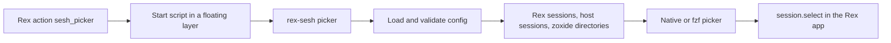

# Contributing

Start here to build and test a change. The [benchmarks](benchmarks.md) page
explains how to measure the picker's performance.

## Set up a checkout

Install Git, Git LFS, and [mise](https://mise.jdx.dev/) before you clone. You
need the Rex app only to try the picker by hand; the unit tests use a fake
`rex`.

```bash
git clone https://github.com/fullerzz/rex-plugin-sesh.git
cd rex-plugin-sesh
git lfs install
git lfs pull
mise install
just build
```

`mise install` installs the tools that `mise.toml` pins:

| Tool | Used for |
| --- | --- |
| Go | Building and testing. `go.mod` sets the minimum Go version; the pin in `mise.toml` can be newer. |
| `golangci-lint` | `just lint`, `just fmt`, and `just fmt-check`. |
| `gotestsum` | `just test`. |
| `just` | The repository recipes. Run `just` to list them. |
| `fzf`, `bat`, `eza` | The `--fzf` picker and the directory and README previews. |
| `git-cliff` | Changelog generation for releases. |
| `prek` | Running the hooks in `.pre-commit-config.yaml`. |
| `uv` | The documentation toolchain. |
| `cargo-binstall` | Installing `eza`, which `mise.toml` pins as a Cargo package. |

Add or change shared tools in `mise.toml`.

### Recipes

Run `just` to list every recipe. These are the ones for day-to-day work:

| Recipe | What it does |
| --- | --- |
| `just build` | Builds `bin/rex-sesh` with the version embedded. |
| `just clean` | Deletes `bin/rex-sesh` and the host builds in `bin/`. |
| `just run` | Runs `./cmd/rex-sesh` with `go run`. |
| `just settings-demo [CONFIG]` | Opens the settings editor on a disposable copy of `testdata/rex-sesh.toml`, or on the config path you pass. |
| `just install-host HOST...` | Builds rex-sesh for each SSH host and installs it there. |
| `just lint` | Runs `golangci-lint`. |
| `just fmt` / `just fmt-check` | Formats the code, or checks the formatting without changing files. |
| `just test` | Runs the race-enabled tests through `gotestsum`. |
| `just check` | Runs `lint`, `fmt-check`, and `test`. |
| `just bench [COUNT]` / `just bench-compare BASE CANDIDATE` | Runs the [benchmarks](benchmarks.md) and compares two saved runs. |
| `just build-docs` / `just serve-docs` | Builds the docs site strictly, or previews it locally. |
| `just test-docs-versions` / `just build-docs-versions` | Tests the versioned docs builder, or builds every docs version. |

### Try your build in Rex

Set up the picker as [Rex setup](../rex-app.md) describes, and write the module
with the binary from your checkout:

```bash
./bin/rex-sesh lua --key 'ctrl+a>s' > ~/.config/rex/sesh.lua
```

The module points at the binary that printed it, and the action starts that
binary each time the picker opens. After `just build`, open the picker again to
run the new build. `just clean` deletes `bin/rex-sesh`, so build again before
you open the picker.

To check the rows without opening the picker or switching the Rex app, print
them as JSON:

```bash
./bin/rex-sesh picker --json
```

### Install your build on hosts

The picker in a host's session runs on that host, with the host's own copy of
`rex-sesh`. Install your build there over SSH:

```bash
just install-host devbox lab
```

Each argument is an SSH host. SSH must log in without a password prompt. For
each host, `install-host` reads its OS and CPU with `uname -sm`, builds
`bin/rex-sesh-GOOS-GOARCH` for it, such as `bin/rex-sesh-linux-amd64`, and
installs it at `~/.local/bin/rex-sesh`. It supports Linux and macOS on `amd64`
and `arm64`. It uploads the binary beside the old copy and then renames it into
place, so a picker that is running keeps its binary. It prints the installed
version. A host's copy stays at that version until you run `install-host`
again.

### Build versions

`just build` and `just install-host` embed `git describe` output: the nearest
`v*` tag, the commits since it, and the commit hash, with `-dirty` for
uncommitted changes. Without a version tag, the version is the commit hash
alone. Without Git metadata, it is `dev`. Check it with
`./bin/rex-sesh --version`.

## Find the code



`rex-sesh list` merges more sources than the picker: Rex sessions,
`[[workspace]]` config entries, and zoxide directories.

| Area | Entry points |
| --- | --- |
| Executable | `cmd/rex-sesh/` |
| Commands, the Rex config module, switching | `internal/app/`. `rex-sesh lua` renders `sesh.lua.tmpl`, and the layer's start script is `pickerStart` in `lua.go`. |
| Rex client | `internal/rex/`. It runs the `rex` CLI with the embedded `sessions.lua` and `screen.lua` scripts. |
| Session sources and merging | `internal/sources/`: Rex sessions on this machine and each host, config entries, zoxide, and a direct path. |
| Session types | `internal/model/` |
| Config schema, defaults, lookup, legacy migration | `internal/config/` |
| Native and fzf picker | `internal/picker/` |
| Settings editor | `internal/settings/` |
| Preview commands and session screens | `internal/preview/` |
| Session cache | `internal/state/` |
| Picker colours | `internal/uitheme/` |
| Naming a directory from Git | `internal/namer/` |

Before you change shared behaviour, read its callers and focused tests. Keep
command routing in `internal/app` and reusable behaviour in its existing
package.

The native picker renders with [bloom](https://bloomfx.dev/). Before you change
`internal/picker/`, read <https://bloomfx.dev/llms.txt> and the linked pages you
need. bloom is pre-1.0, and its site documents the latest release. When the
site and the code disagree, trust `go doc` for the version in `go.mod`.

## Verify a change

Start with the package you changed, for example:

```bash
go test -race -count=1 ./internal/config
```

Then run the checks for the kind of change:

| Change | Checks |
| --- | --- |
| Go behaviour | `just check`, `go vet ./...`, `just build`, then the CLI smoke commands below |
| Picker layout or text | The golden picker frames below, then the picker in Rex |
| Documentation | `just build-docs`, then inspect the pages with `just serve-docs` |
| Navigation, versioning, or docs build configuration | `just test-docs-versions`, `just build-docs`, `just build-docs-versions` |
| Docs Python scripts | `uv run --frozen ruff check .`, `uv run --frozen ruff format --check .`, plus the versioning checks |
| Performance-sensitive behaviour | A baseline and candidate comparison from [Benchmarks](benchmarks.md) |

```bash
./bin/rex-sesh --version
./bin/rex-sesh list --json --config testdata/rex-sesh.toml
./bin/rex-sesh list --json --config testdata/sesh.toml
git diff --check
```

The two fixtures cover the native config and legacy Sesh compatibility. The
legacy fixture's deprecation warning on stderr is expected. `list` also asks
your Rex server and hosts for their sessions. Without a Rex server, it prints
one warning and still exits 0.

!!! note "What just check includes"

    `just check` runs `just lint`, `just fmt-check`, `just test`, and
    `just test-release-ref`. It does
    not build the binary or the documentation. Before you open a pull request,
    also run the build and smoke commands, and the docs checks when
    documentation changes.

### Tests and your machine

The unit tests need neither Rex nor zoxide, and they don't touch your Rex
sessions, cache, or zoxide history:

- `TestMain` in `internal/app/main_test.go` writes a fake `rex` to a temporary
  directory and points `REX_SESH_REX_BIN` at it. The fake records each call and
  answers with no sessions. It uses only shell builtins, because some tests
  empty `PATH`.
- The same `TestMain` sets `REX_SESH_STATE_DIR` to a temporary directory and
  `_ZO_DATA_DIR` to an empty zoxide database. It unsets `REX_BLOCK`,
  `REX_SESSION`, and `REX_CLIENT`, which Rex terminals set.
- Tests that need other answers write their own fake `rex` or `zoxide` script
  to a temporary directory.
- `internal/rex` tests give the client a fake runner instead of a `rex`
  process.
- The start script tests run `pickerStart` with `/bin/sh` against stub
  binaries.

One picker test runs your installed `fzf`, and it skips when `fzf` is missing.

### Golden picker frames

`TestPickerFramesMatchGolden` in `internal/picker/bloom_test.go` renders the
native picker at fixed sizes and in fixed states. It compares each screen,
without colours, with a text file in `internal/picker/testdata/frames/`. When
you change the picker's layout or text on purpose, write the frames again and
review the diff:

```bash
UPDATE_PICKER_FRAMES=1 go test ./internal/picker -run TestPickerFramesMatchGolden
git diff internal/picker/testdata/frames
```

### Test conventions

Put `Test<Behavior>` tests beside the code. Write the smallest regression test
that fails for the behaviour you change. Reuse the existing fakes instead of a
live Rex server. Keep fixtures in `testdata/`.

Use Testify `require` for prerequisites, such as errors, nil values, and lengths
before indexing. Use `assert` for independent expectations. Keep `require` on
the test goroutine, and send worker errors back to it. `just lint` checks
assertion usage. For interactive changes, also try the picker in Rex, including
a narrow terminal when the layout changes.

## Work on documentation

Edit the pages in `docs/`, and add navigation entries in `zensical.toml`.
`site/` is generated output. Use the pinned Python environment through `uv`,
and `xh` for HTTP checks.

```bash
just serve-docs
```

Open the address that Zensical prints. Check links, code copying, tabs,
diagrams, and narrow-screen navigation. Use admonitions for important
behaviour, and code annotations for settings that need explaining. Keep basic
instructions visible.

### Versions and deployment

The versioned builder takes `latest` from the current checkout. It adds a
snapshot for each `v*` release tag that contains `docs/` and `zensical.toml`,
built from that tag. The first release with docs is `v0.1.0`.

To build and test every version:

```bash
git fetch --tags
git lfs fetch --all
just test-docs-versions
just build-docs-versions
```

The builder writes into `site/` and pushes nothing. It redirects unversioned
links to `latest`. Keep `site_url` unversioned.

The Docs workflow builds the versioned site for pull requests, pushes to
`main`, `v*` tags, and manual runs. Except for pull requests, it then deploys
the site to GitHub Pages at <https://fullerzz.github.io/rex-plugin-sesh/>.

## Pull requests and releases

Use Conventional Commit subjects, such as
`fix: list every zoxide directory, naming clashes by their parents`. Keep them
imperative, with a type such as `feat:`, `fix:`, `ci:`, or `docs:`.

In the pull request, describe the change, link its issue when there is one, and
list the exact validation commands you ran. Include CLI output or screenshots
only when the change alters what users see.

### Releases

The git tag is the version. `just release vMAJOR.MINOR.PATCH` (with an
optional `-prerelease`) checks that you are on a clean `main` and that the tag
is new, runs `just check`, builds and smoke-tests the binary, writes
`CHANGELOG.md` for the tag with git-cliff, commits it, tags it and pushes both.
It needs `GITHUB_TOKEN` for the changelog's GitHub metadata. Preview the
changelog first with `just preview-changelog vMAJOR.MINOR.PATCH`.

The tag push starts the Release workflow. It tests the tag, builds
`rex-sesh_VERSION_OS_ARCH.tar.gz` for Linux and macOS on amd64 and arm64, with
`checksums.txt`, writes the release notes, and publishes the GitHub release.

The changelog starts at the Rex fork. `.github/scripts/changelog-range.sh`
holds the last Herdr commit and gives every git-cliff call its commit range, so
Herdr history never appears. `just test-release-ref`, part of `just check`,
tests the release tooling.
